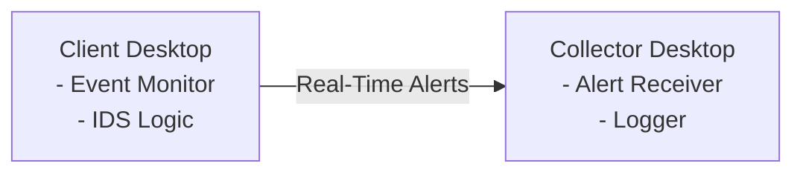

# Continuous Monitoring

Continuous Monitoring is a desktop-based security monitoring project designed to detect and report real-time threats from a **client system** to a **collector system**. The goal is to provide lightweight, host-based intrusion detection with real-time visibility into suspicious activities.

---

## 📌 Project Overview

The project follows a **client–collector architecture**:

- **Client Desktop**  
  Monitors system activity and detects potential security threats.

- **Collector Desktop**  
  Receives, logs, and displays threat alerts in real time.

Currently, the system focuses on detecting **failed logon attempts** as a basic Intrusion Detection System (IDS). Future updates will expand detection capabilities to cover malware and PowerShell-based threats.

---

## 🚀 Features

### ✅ Implemented
- Real-time monitoring of **failed logon attempts**
- Host-based IDS functionality
- Real-time alert transmission from client to collector
- Basic threat reporting and logging
- USB Monitoring
- 

### 🔜 Planned
- Malware detection
- Detection of malicious PowerShell activity
- Enhanced alert correlation
- Improved logging and visualization
- Support for additional Windows security events

---

## 🛠️ Architecture

---

## ⚙️ How It Works

1. The client continuously monitors system security events.
2. When suspicious activity (e.g., multiple failed logon attempts) is detected:
   - An alert is generated.
   - The alert is sent to the collector in real time.
3. The collector receives and logs the alert for analysis.

---

## 🔐 Use Cases

- Endpoint security monitoring
- Educational IDS implementation
- Security research and experimentation
- Learning host-based threat detection techniques

---

## 🧩 Future Enhancements

- Signature-based and behavior-based malware detection
- PowerShell command analysis and anomaly detection
- Encrypted communication between client and collector
- Dashboard for real-time alert visualization

---

## 📖 Disclaimer

This project is intended for **securityAstra**. It is not a replacement for enterprise-grade security solutions.

---

## 📜 License

[MIT License](LICENSE)

